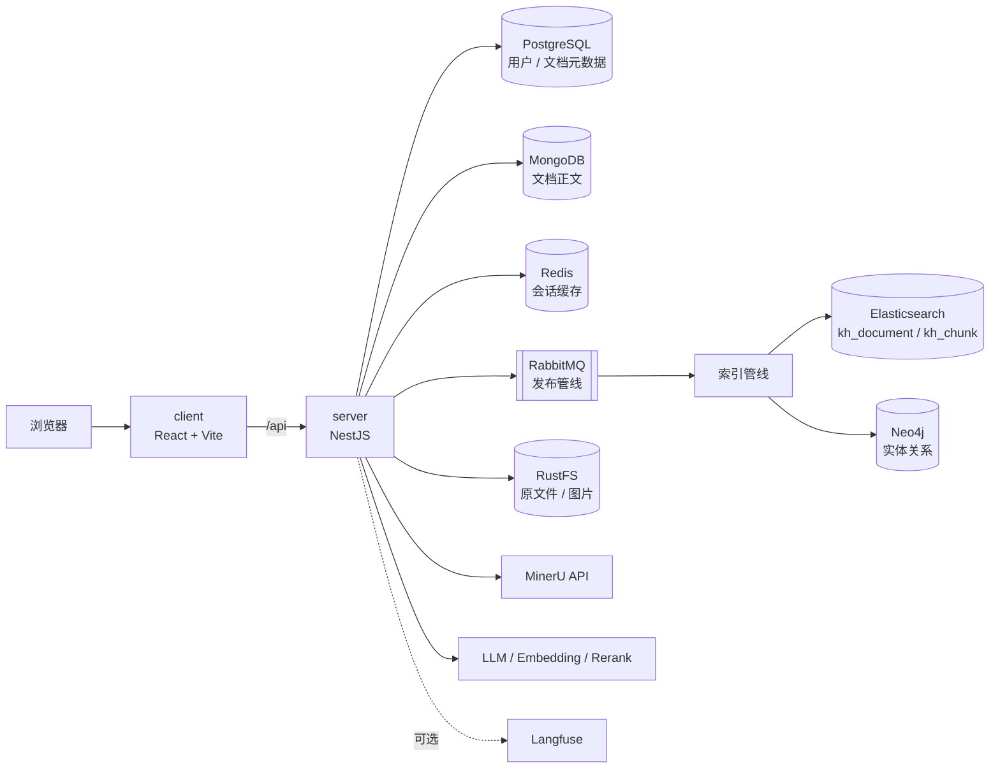
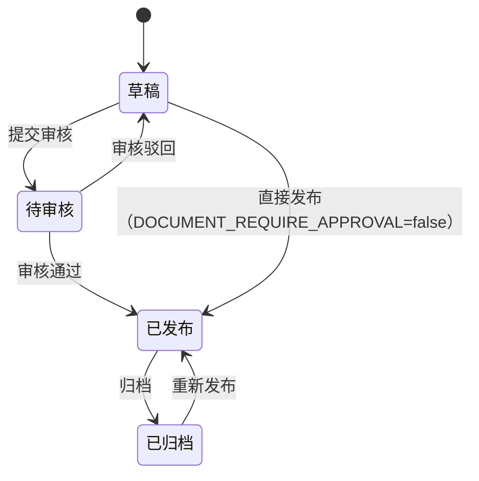

# knowledge-hub

一个面向团队的知识库中台：文档从上传、审核、发布，到全文检索、混合检索、Agentic RAG 问答、知识图谱，形成一条完整的知识生产与消费链路。

前端 React 管理台与服务端 NestJS API 同仓库维护，目录分为 `client` 和 `server`。

## 功能概览

- **文档生命周期**：草稿 / 待审核 / 已发布 / 已归档，发布支持可选的审核流程
- **异步发布管线**：文档发布后经 RabbitMQ 分发到三条索引链路
  - RAG 分块 + 向量化 → Elasticsearch `kh_chunk`
  - 文档级关键词索引 → Elasticsearch `kh_document`
  - 实体关系抽取 → Neo4j 知识图谱
- **混合检索**：BM25 关键词召回 + 向量 kNN 召回 → RRF 融合 → rerank 精排
- **Agentic RAG**：模型自主调用 `retrieve_knowledge` / `retrieve_graph` / `rewrite_query` / `web_search`，检索不足时改写再查，仍不足才联网
- **对话记忆**：Redis 短期热窗口 + PostgreSQL 持久化，可选接入 Mem0 长期记忆
- **权限与可见性**：JWT → 角色 → 权限码 → 资源归属四层校验；普通用户可见「本人创建 ∪ 已发布且公开 ∪ 已发布且同团队」，管理员 / 审核员不受限，过滤条件下沉到 Elasticsearch / Neo4j 查询层
- **文件解析**：PDF / Word / PPT / Excel / 图片经 MinerU 转为 Markdown，图片回传 RustFS；txt / md 本地直读
- **可观测与评测**：可选接入 Langfuse / OpenTelemetry，内置 RAG 离线评测脚本

## 架构



### 文档状态机



- `DOCUMENT_REQUIRE_APPROVAL=true`（默认）时，发布先进入待审核
- 待审核期间禁止修改正文；已发布文档再次提审会先清理索引
- 只有已发布文档会写入检索与图谱索引

### 发布管线

```text
发布文档
   └─ RabbitMQ（3 个 topic exchange）
        ├─ rag.reindex.exchange    → 分块、Embedding → kh_chunk
        ├─ search.index.exchange   → 文档级关键词索引 → kh_document
        └─ kg.graph.exchange       → LLM 抽取实体关系 → Neo4j
```

### 检索与问答

1. 关键词召回与向量召回并行执行
2. RRF（Reciprocal Rank Fusion）融合两路结果
3. rerank 精排并按 `RAG_MIN_SCORE` 过滤
4. Agent 拿到候选后评估是否切题：不切题先改写检索词再查，仍不足才联网兜底

## 技术栈

| 层       | 选型                      | 原因                                           |
| -------- | ------------------------- | ---------------------------------------------- |
| 前端     | React + Vite + Ant Design | 管理台组件完整，构建快                         |
| 服务端   | NestJS + TypeORM          | 模块化、守卫体系适合分层鉴权                   |
| 关系库   | PostgreSQL                | 用户、角色、权限、文档元数据需要事务           |
| 文档库   | MongoDB                   | 长正文结构灵活，与元数据解耦                   |
| 检索     | Elasticsearch 8 + IK      | 关键词与向量检索放在同一引擎，中文分词可定制   |
| 图谱     | Neo4j                     | 实体关系遍历和可视化更自然                     |
| 队列     | RabbitMQ                  | 发布后索引链路解耦，topic 路由便于扩展         |
| 缓存     | Redis                     | 对话短期窗口、验证码                           |
| 对象存储 | RustFS（S3 兼容）         | 原文件与解析图片统一存储，可替换为任意 S3 实现 |
| Agent    | LangChain + AI SDK        | 工具编排与流式输出                             |
| 追踪     | Langfuse / OpenTelemetry  | 可选，缺失时不影响主流程                       |

## 目录结构

```text
knowledge-hub/
├── server/                    # NestJS 服务端
│   ├── src/
│   │   ├── auth/              # JWT、角色/权限守卫
│   │   ├── user/              # 用户、角色、权限
│   │   ├── team/              # 团队与成员
│   │   ├── document/          # 文档生命周期、审核、解析
│   │   ├── search/            # 文档级关键词检索
│   │   ├── mq/                # RabbitMQ 拓扑与消费者
│   │   ├── pipeline/          # 分块、Embedding、ES 索引、KG 抽取
│   │   ├── ai/                # 混合检索、Agentic RAG、会话记忆、评测
│   │   ├── graph/             # 图谱查询
│   │   ├── storage/           # RustFS
│   │   ├── redis/
│   │   └── observability/
│   ├── init-scripts/          # PostgreSQL / MongoDB 初始化
│   ├── elasticsearch/         # 带 IK 分词的 ES 镜像
│   └── docker-compose.yml     # 本地基础设施
└── client/                    # React 管理台
    └── src/
        ├── api/               # 请求封装与 token 刷新
        ├── layouts/
        ├── pages/             # 文档、搜索、问答、图谱、管理台
        └── components/
```

## 快速开始

### 环境要求

- Node.js 22
- pnpm 9+
- Docker Compose v2
- 建议 4 核 8 GiB 以上（Elasticsearch、Neo4j、MongoDB、RabbitMQ 同时运行）

### 1. 启动基础设施

```bash
cd server
cp .env.example .env
docker compose up -d
```

首次启动会拉取 PostgreSQL(pgvector)、MongoDB、Redis、RabbitMQ、Elasticsearch（本地构建，带 IK 分词）、RustFS、Neo4j。

### 2. 启动服务端

```bash
cd server
pnpm install
pnpm start:dev
```

服务监听 `http://localhost:3000`。

### 3. 启动前端

```bash
cd client
pnpm install
pnpm dev
```

浏览器打开 `http://localhost:5173`，开发环境 `/api` 代理到 3000。

### 预置账号

`init-scripts/postgresql/init.sql` 初始化了三个账号，密码均为 `123456`：

| 账号       | 角色            | 用途           |
| ---------- | --------------- | -------------- |
| `admin`    | 管理员 + 审核员 | 系统管理、审核 |
| `reviewer` | 审核员          | 文档审核       |
| `user`     | 普通用户        | 文档与检索     |

## 演示流程

建议按下面的顺序演示，覆盖核心链路：

1. 用 `user` 登录，创建文档并上传一个 PDF，查看 MinerU 解析出的 Markdown 与图片
2. 提交审核，切换到 `reviewer` 或 `admin` 审核通过
3. 文档进入已发布状态，等待发布管线完成分块、向量索引与图谱抽取
4. 在搜索页执行关键词检索，确认只返回当前用户可见的文档
5. 在问答页提问，观察 `retrieve_knowledge` / `retrieve_graph` 的评估、改写与引用来源
6. 打开图谱页，查看实体与关系

## 必要配置

`.env` 中以下 Key 不配会直接影响功能，建议至少配置前两项：

| 变量                                                                  | 必填     | 作用                        | 缺失时的表现                                         |
| --------------------------------------------------------------------- | -------- | --------------------------- | ---------------------------------------------------- |
| `DASHSCOPE_API_KEY` 或 `EMBEDDING_API_KEY`（可回退 `OPENAI_API_KEY`） | 是       | 文本向量化                  | 三个 Key 都为空时启动失败；填无效值则索引/检索时报错 |
| `OPENAI_API_KEY`                                                      | 是       | RAG 问答、KG 抽取           | 调用问答 / 发布抽取时报错                            |
| `MINERU_API_TOKEN`                                                    | 建议     | PDF / Office / 图片解析     | 上传这些格式时报错，txt / md 不受影响                |
| `RERANK_API_KEY`                                                      | 否       | 检索结果精排                | 回退到 DashScope/OpenAI Key；都未配则跳过重排        |
| `BOCHA_API_KEY`                                                       | 否       | 联网兜底                    | 联网工具返回未配置提示                               |
| `JWT_SECRET`                                                          | 生产必改 | 签发 access / refresh token | 使用默认 dev 值，存在安全风险                        |
| `MEM0_API_KEY`                                                        | 否       | 长期记忆                    | 跳过长期记忆                                         |
| `LANGFUSE_*`                                                          | 否       | 链路追踪与评测上报          | 只打本地日志                                         |
| `MAIL_*`                                                              | 否       | 注册验证邮件                | 需开启邮箱验证时才会用到                             |

完整变量见 [server/.env.example](server/.env.example)。

## 核心代码索引

| 主题           | 位置                                                                         | 说明                                    |
| -------------- | ---------------------------------------------------------------------------- | --------------------------------------- |
| 文档状态与流转 | [document-status.ts](server/src/document/document-status.ts)                 | 状态定义、可发布 / 可编辑 / 可归档规则  |
| 审核流程       | [document-review.service.ts](server/src/document/document-review.service.ts) | 提交审核、通过、驳回、索引清理          |
| 可见性规则     | [document-access.ts](server/src/document/document-access.ts)                 | 公开 ∪ 团队 ∪ 本人；ES / Neo4j 过滤条件 |
| MQ 拓扑        | [mq.constants.ts](server/src/mq/mq.constants.ts)                             | 3 个交换机、队列与路由键                |
| 发布管线消费者 | [document-pipeline.consumer.ts](server/src/mq/document-pipeline.consumer.ts) | RAG / Search / KG 三路消费              |
| 向量索引       | [vector-index.service.ts](server/src/pipeline/vector-index.service.ts)       | `kh_chunk` 建索引、写入、kNN            |
| 混合检索       | [hybrid-retrieval.service.ts](server/src/ai/hybrid-retrieval.service.ts)     | 双路召回、RRF、rerank                   |
| Agentic RAG    | [ai-stream.service.ts](server/src/ai/ai-stream.service.ts)                   | 工具定义、Agent 循环、流式输出          |
| 鉴权守卫       | [auth/](server/src/auth/)                                                    | JWT → 角色 → 权限码                     |
| 前端请求层     | [client.ts](client/src/api/client.ts)                                        | baseURL、token 刷新、错误处理           |

## 已知限制

这些是当前实现的真实边界，后续可以逐项补强：

- **没有版本化数据库迁移**：TypeORM `synchronize: false`，仅靠 `init-scripts` 建表；表结构变更需要手工迁移
- **MQ 没有重试与死信队列**：消费失败时 `nack` 不重回队列，索引任务会丢失
- **权限计算没有缓存**：每次鉴权会查询用户角色与权限，QPS 高时会成为瓶颈
- **refresh token 不可撤销**：无状态签发，改密或封禁后旧 token 在有效期内仍可用
- **前后端契约手工维护**：前端 `types.ts` 为手写类型，未从 OpenAPI 生成，存在漂移风险
- **部分前端页面缺少后端接口**：收藏、通知、分享、分类、广播等页面尚未配套服务端实现
- **外部解析依赖**：PDF / Office / 图片解析依赖 MinerU，未配置 Token 时不可用
- **单机基础设施**：本地 compose 为单节点，不具备生产级高可用

## 安全说明

- `server/docker-compose.yml` 是本地开发配置，包含管理界面和弱口令，**不要直接用于公网部署**
- 公网演示前请修改预置账号密码、更换 `JWT_SECRET`，并关闭 PostgreSQL、MongoDB、Redis、RabbitMQ、Elasticsearch、Neo4j 的宿主机端口映射
- `server/test-files/` 为本地测试数据，已被 `.gitignore` 排除，不会进入仓库
- `.env` 已被 `.gitignore` 忽略，请勿提交任何真实密钥

## 说明

本项目在开源知识库项目基础上做了整理与二次开发，用于个人学习与面试演示。
